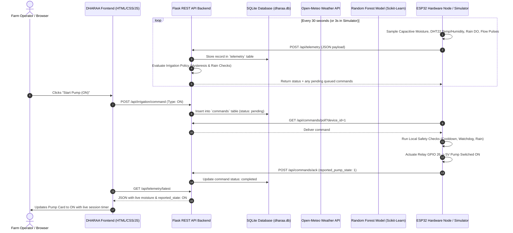

# 🌾 DHARAA Smart Irrigation Platform — System Architecture & Feature Guide

> **Project:** DHARAA (Smart Irrigation & Agronomic IoT System)  
> **Repository:** [https://github.com/p-srishanth-reddy/DHARAA-Smart-Irrigation](https://github.com/p-srishanth-reddy/DHARAA-Smart-Irrigation)  
> **Tech Stack:** Python Flask · SQLite · ESP32 (MicroPython) · Vanilla HTML5/CSS/JavaScript · Chart.js · Scikit-Learn

---

## 📖 Executive Summary

**DHARAA** is an Internet of Things (IoT) precision agriculture and smart irrigation web platform. It automates farm watering based on real-time soil moisture and environmental conditions, prevents pump dry-runs and waterlogging, provides AI-driven crop selection advice, and delivers 24-hour meteorological forecasting without requiring any third-party paid subscriptions or complex infrastructure.

---

## 🏗️ Part 1: How the Entire System Works (End-to-End Flow)



### 1. Hardware Edge Layer (`esp32_firmware/`)
- **Microcontroller:** ESP32 running MicroPython.
- **Sensors:**
  - **Capacitive Soil Moisture Sensor (ADC GPIO 34):** Reads raw analog soil impedance and converts it into a calibrated 0–100% moisture percentage using linear dry/wet calibration:
    $$\text{Moisture \%} = 100 \times \frac{\text{Dry Raw} - \text{Raw}}{\text{Dry Raw} - \text{Wet Raw}}$$
  - **DHT22 Microclimate Sensor (GPIO 5):** Measures ambient field temperature (°C) and relative humidity (% RH).
  - **Surface Rain Sensor (DO GPIO 14):** Detects raindrops on the field surface for immediate rain inhibition.
  - **Water Flow Sensor (GPIO 27):** Uses a hardware interrupt on rising edge pulses to measure water flow ($P = 450\text{ pulses/litre}$).
  - **Relay Module (GPIO 26):** Switches 5V power to the submersible water pump.
- **Local Firmware Watchdog (`safety.py`):** Ensures that the pump **always powers OFF on startup**, limits any single irrigation session to a hard **5-minute maximum**, enforces a **10-minute cooldown** between cycles, and maintains local safety even if Wi-Fi or server connectivity drops.

### 2. Backend & Persistence Layer (`backend/`)
- **Framework:** Python Flask with modular Blueprints.
- **Database:** SQLite (`backend/dharaa.db`) featuring 8 relational tables:
  1. `users`: Operator authentication and metric/timezone preferences.
  2. `farms`: Agricultural plot coordinates, acreage, soil taxonomy, and crop cultivars.
  3. `devices`: Registered ESP32 edge nodes and cryptographic token hashes.
  4. `telemetry`: Timestamped sensor readings (moisture, temp, humidity, rain, flow, pump state).
  5. `schedules`: Configured automated irrigation windows and moisture thresholds.
  6. `irrigation_events`: Historic pump run records with duration, estimated volume, and stop reasons.
  7. `commands`: Asynchronous command state machine (`pending` $\to$ `delivered` $\to$ `acknowledged` $\to$ `completed`).
  8. `notifications`: Alert logs (critical stops, rain notifications, threshold crossings).

### 3. External Intelligence & ML Layer
- **Open-Meteo Weather Service (`weather_service.py`):** Fetches real-time temperature, humidity, wind velocity, and 24-hour rain probabilities using farm GPS coordinates. Includes a 30-minute in-memory cache to prevent redundant requests. Requires **no API keys** or user accounts.
- **Random Forest Crop Recommendation Model (`crop_model.joblib`):** Trained on 2,200 agronomic records across 22 crop classes, achieving **95.0% held-out test accuracy** based on soil macronutrients (N, P, K), pH, temperature, humidity, and rainfall.

### 4. Modern SaaS Frontend (`frontend/`)
- Pure HTML5, Vanilla CSS, and JavaScript with Chart.js.
- Clean, nature-inspired green design system (`#166534`, `#228B45`, `#F5F7F5`) with responsive cards, subtle borders, and smooth transitions.
- Fully responsive across desktop, tablet, and mobile with a collapsible navigation drawer.

---

## 🖥️ Part 2: Which Dashboard Handles Which Features?

The DHARAA web application is organized into **7 dedicated dashboard pages**, accessible from the left navigation sidebar:

| Page | URL Route | Primary Function | Key Features Handled |
|------|-----------|------------------|----------------------|
| **1. Farm Dashboard** | `/` or `/dashboard` | Real-time monitoring & pump control | Live sensor telemetry cards, pump actuation station, hysteresis rule engine status, recent events table, hardware availability matrix |
| **2. My Farms** | `/farms` | Farm property management | Register new farms, GPS coordinates, land area, soil taxonomy, assign ESP32 devices, archive farms |
| **3. Schedules** | `/schedules` | Automated irrigation planning | Create time-based irrigation windows, target moisture levels, pre-flight safety checklist verification |
| **4. Weather Forecast** | `/weather-view` | Meteorological intelligence | Open-Meteo 24-hour forecast, hourly precipitation probability bar chart, temperature curve, rain inhibition alerts |
| **5. AI Crop Advisor** | `/advisor-view` | Agronomic decision support | Random Forest crop prediction (N-P-K & climate inputs), confidence score, runner-up cultivars, FAO-56 irrigation advice |
| **6. Analytics** | `/analytics-view` | Historical trends & accounting | 7-day soil moisture trend bar chart, daily pump runtime line graph, total telemetry points, flow volume transparency |
| **7. Profile & Security** | `/profile-view` | Operator settings & node security | Timezone & measurement units (Metric/Imperial), ESP32 authentication secret key box, real-time alert notification inbox |

---

## 🔍 Detailed Walkthrough of Each Dashboard Page

### 1. Farm Dashboard (`/`)
The primary mission control center for daily farm operations:
- **Header:** Shows the currently active farm, selected ESP32 edge node, and an online status badge showing the exact age of the latest telemetry packet (e.g., *"Live Telemetry (Updated 2s ago)"* or *"Stale"* if older than 120s).
- **Summary Metric Cards:**
  - **Soil Moisture:** Shows current root zone moisture percentage with a colored visual progress bar (green for safe, amber for dry).
  - **Ambient Temperature:** Live DHT22 reading in degrees Celsius.
  - **Relative Humidity:** Live DHT22 reading in percentage.
  - **Pump Operational State:** Real-time state reported by the relay hardware (ON or OFF).
- **Sensor Diagnostics:** Real-time readings from the digital surface rain sensor (*"Dry Field"* vs. *"Rain Detected"*) and water flow meter (*pulses & estimated litres*).
- **Irrigation Actuation Station:**
  - Displays distinct **Requested State** (what the user ordered) vs. **Reported Hardware State** (what the ESP32 relay confirmed).
  - Active session runtime stopwatch counter.
  - **Start Pump (ON):** Queues a start command with confirmation dialog.
  - **Stop Pump (OFF):** Safely terminates watering and logs the session.
  - **🚨 Emergency Stop:** Big red button that immediately overrides all schedules and AI recommendations, locks out the hardware relay, and triggers a critical alert.
- **Rule Engine Summary Box:** Explains in plain English why the pump is on or off (e.g., *"Soil moisture (31.5%) is BELOW trigger threshold (35.0%). Automated irrigation requested ON"*).
- **Recent Activity Table:** Displays the 5 most recent irrigation events with start time, status, trigger source, estimated litres, and stop reason.
- **Hardware Availability Matrix:** Honestly indicates which hardware is present versus unmonitored (e.g. Tank Level: Not Monitored) so operators never see fabricated data.

---

### 2. My Farms (`/farms`)
Manages all landholdings and farm properties:
- **Farm Cards:** Shows each registered plot with its name, crop cultivar (e.g. Cotton, Wheat), location (State/District, latitude/longitude), land area (acres), soil type, and water source.
- **"Select on Dashboard" Button:** Switches the active farm on the main dashboard with one click.
- **"Archive" Button:** Soft-deletes a farm without corrupting historical telemetry records.
- **"Register New Farm" Modal:** Two-column clean form allowing the operator to input plot name, coordinates, land area, and select from common soil taxonomies (Black Cotton, Loamy, Sandy Loam, Alluvial, Red Soil). Automatically provisions a paired ESP32 device node in the database.

---

### 3. Schedules (`/schedules`)
Configures automated recurring irrigation sessions:
- **Pre-Flight Safety Verification Banner:** Summarizes the 4 safety rules checked before any schedule runs (Device Online, Rain Inhibit, Cooldown Safe, Local Watchdog Limit).
- **Configured Schedules Table:** Lists all schedules with description, target farm, start time (24h format), target soil moisture (%), runtime cap (seconds), active/paused status, and delete action.
- **"Create Schedule" Modal:** Allows setting daily start times (e.g. `06:00` for pre-dawn watering), target moisture recovery level (e.g. `45%`), runtime limits, and agronomic field notes.

---

### 4. Weather Intelligence (`/weather-view`)
Monitors atmospheric conditions using live Open-Meteo data:
- **Current Conditions Cards:** Forecasted 2-meter temperature, relative humidity, precipitation rate (mm), and surface wind velocity (km/h).
- **24-Hour Horizon Chart:** Dual-axis visualization with blue bars for hourly precipitation probability (%) and an orange curve for ambient temperature (°C).
- **Retrieval & Staleness Badge:** Shows exact timestamp of the forecast data and marks data as cached/stale if connectivity drops.
- **Weather-Based Irrigation Advisory:** Explains when rain is expected and how irrigation will be adjusted to conserve water.

---

### 5. AI Agronomic Advisor (`/advisor-view`)
Provides two levels of intelligent decision support:
1. **Machine Learning Crop Recommendation:**
   - Input form for soil macronutrients (Nitrogen, Phosphorus, Potassium), ambient temperature, humidity, soil pH, and annual rainfall.
   - **Quick Archetype Presets:** One-click buttons to load archetypes (*Cotton (Semi-arid)*, *Rice (Wetland)*, *Chickpea (Dryland)*, *Maize (Temperate)*).
   - **Inference Results Card:** Displays the recommended crop name in large typography, the statistical model confidence percentage (e.g., *98.6%*), and compatible runner-up cultivars with percentage match.
   - **Agronomic Disclaimer:** States clearly that statistical macro-climate predictions complement but do not replace laboratory soil pathology tests.
2. **Real-Time Evapotranspiration & Irrigation Advisory:**
   - Evaluates live soil moisture against crop stage and weather forecast.
   - Returns urgency rating (*CRITICAL*, *MODERATE*, *LOW*, or *INHIBITED DUE TO RAIN*), recommended cycle duration in minutes, and actionable agronomic advice points based on FAO-56 dual crop coefficient principles.
3. **Fertilizer & Plant Pathology Guidance Cards:** Outlines nutrient split-application strategies and notes requirements for camera-based leaf disease detection.

---

### 6. Historical Analytics (`/analytics-view`)
Analyzes long-term farm trends:
- **KPI Summary Cards:** Total continuous telemetry samples logged, lifetime irrigation cycles recorded, and flow meter calibration factor ($450\text{ pulses/L}$).
- **7-Day Soil Moisture Bar Chart:** Shows daily average moisture levels to identify whether root zone depletion is trending dry or wet over time.
- **7-Day Daily Pump Runtime Line Chart:** Tracks minutes of daily pump operation to detect leaks, abnormal runtimes, or excessive water use.
- **Volumetric Transparency Notice:** Explains that water consumption in liters is only calculated when backed by calibrated flow meter pulses.

---

### 7. Operator Profile & Node Security (`/profile-view`)
Manages system configuration and alert history:
- **Operator Profile Form:** Displays username, registered email, and dropdowns to configure timezone (e.g., `Asia/Kolkata`) and measurement units (Metric: °C, Litres vs. Imperial: °F, Gallons).
- **ESP32 Node Authentication Secret Key:** Displays the hardware API secret token (`dharaa-esp32-secret-2026`) with a "Show/Hide" toggle so operators can copy it into their ESP32 `config.py` file.
- **Real-Time Notification Inbox:** Chronological feed of all system alerts with color-coded severity tags:
  - 🔴 **Critical:** Emergency stops, sensor failures, and local watchdog timeouts.
  - 🟢 **Success:** Target moisture recovery reached and schedule completions.
  - 🔵 **Info:** Rain detections, manual commands queued, and system welcome messages.

---

## ⚙️ Part 3: Automated Control Rules & Safety Logic

The core automated irrigation policy implemented in `backend/services/irrigation_service.py` follows these deterministic rules:

```
                          ┌────────────────────────┐
                          │ Incoming Telemetry Pkt │
                          └───────────┬────────────┘
                                      │
                         Is sensor status == 'OK'?
                                     / \
                               YES  /   \  NO
                                   /     \
                                  │       └─► Force Pump OFF (Sensor Error)
                    Is Rain detected (DO==1)?
                                 / \
                           NO   /   \  YES
                               /     \
                              │       └─► Force Pump OFF (Rain Inhibit)
                 Is Pump currently OFF?
                             / \
                       YES  /   \  NO (Pump is currently ON)
                           /     \
       Moisture < 35.0%?          Moisture >= 45.0% OR Runtime > 300s?
             / \                                  / \
       YES  /   \  NO                       YES  /   \  NO
           /     \                              /     \
          ▼       ▼                            ▼       ▼
    Queue Pump ON  Stay Idle             Queue Pump OFF  Keep Running
```

1. **Hysteresis Band:** The pump starts when soil moisture drops below **35.0%** and stops when moisture recovers to **45.0%**. This 10% deadband prevents rapid on/off relay chatter.
2. **Rain Inhibit:** If surface moisture is detected by the rain sensor, the pump is immediately stopped or prevented from starting.
3. **Local Hardware Watchdog:** In the MicroPython firmware, if the pump runs continuously for **300 seconds (5 minutes)**, the ESP32 cuts relay power locally even if disconnected from Wi-Fi.
4. **Mandatory Cooldown:** A minimum **10-minute off-period** is required between irrigation cycles to allow soil water percolation and protect the pump motor from overheating.
5. **Emergency Stop:** Overrides all schedules and AI commands with an immediate hardware shutdown.

---

## 🚀 Part 4: How to Run the Project

### Running the Backend & Web Application
```powershell
# In terminal:
python -m backend.app
```
- Open your browser to: **`http://localhost:5000`**

### Running the Virtual Hardware Node (Simulator)
If physical hardware is not yet plugged in, test live sensor dynamics with the simulator:
```powershell
# In a second terminal:
python simulate_esp32.py
```
- The simulator mimics capacitive soil drying, generates water pulses when the pump runs, responds to manual ON/OFF/Emergency Stop commands, and reports live status to the web dashboard.

### Deploying to Physical ESP32 Hardware
1. Flash **MicroPython** onto the ESP32 board.
2. Open `esp32_firmware/config.py` and update `WIFI_SSID`, `WIFI_PASS`, and set `BACKEND_URL` to your computer's LAN IP address (e.g. `http://192.168.1.50:5000`).
3. Upload all files from `esp32_firmware/` to the ESP32 root using Thonny or `mpremote`.
4. Power on the ESP32.
